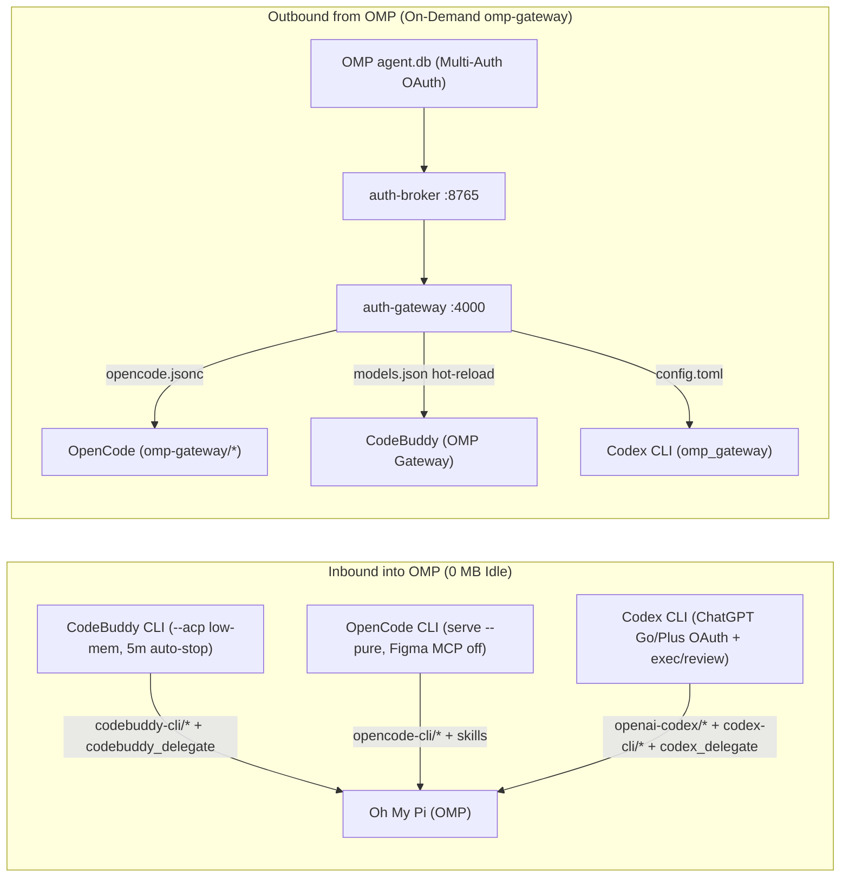

# omp-bridges

Zero-idle-RAM (`0 MB` when inactive) bidirectional integration between **Oh My Pi (`omp`)**, **CodeBuddy CLI**, **OpenCode CLI**, and **OpenAI Codex CLI**, complete with autonomous sub-agent delegates, on-demand OAuth gateway model sync, a unified 4-in-1 quota inspector, and a portable Agent Skill.

Works across **Windows**, **macOS**, and **Linux** without hardcoded paths.

---

## Architecture



### Key Features
- **CodeBuddy -> OMP (`codebuddy-cli/*`):** Persistent JSON-RPC 2.0 `codebuddy --acp` daemon with V8 low-memory flags (`--optimize-for-size --max-semi-space-size=2` + `codebuddy-lite-wb.mjs`, ~44% lower RAM) that starts lazily and stops automatically after 5 minutes idle. Defaults `@codebuddy` to `deepseek-v4.1-flash` (`x0.00` free credit multiplier).
- **Codex CLI -> OMP (`openai-codex/*` + `codex-cli/*`):** Hybrid integration. Imports `~/.codex/auth.json` into OMP's native WebSocket/SSE `openai-codex` store, installs `omp-codex-reserve` to expose `gpt-reserve`, registers `codex-cli/*` (`codex exec --json`), and provides `codex_delegate` (including non-interactive `codex review`).
- **OpenCode -> OMP (`opencode-cli/*`):** Resolves native `opencode.exe` on Windows (avoiding `.cmd` `spawn` failures), runs `opencode serve --pure` without remote MCP delays (`disabledServers: ["figma"]`), and surfaces `session.error` / `free_tier_limit` immediately instead of hanging.
- **OMP -> OpenCode, CodeBuddy, & Codex (`omp-gateway`):** On-demand supervisor for `omp auth-broker serve` + `omp auth-gateway serve`. Keeps `auth.broker.url` out of global `config.yml` so `omp` never breaks after reboot when the broker is stopped. Atomically syncs `google-antigravity/*`, `openai-codex/*`, and `zai/*` into `opencode.jsonc`, `~/.codebuddy/models.json`, and `~/.codex/config.toml`.
- **Unified 4-in-1 Quota Checker (`omp-gateway quota`):** Displays OMP multi-account bars (`google-antigravity`, `openai-codex` + saved reset credits, `zai`), CodeBuddy credit multipliers (`x0.00` free vs paid tiers), and OpenCode Free daily reset countdown + 24h local token stats in one command.

---

## Quick Setup (New Laptop or Other Users)

### Prerequisites
- [Bun](https://bun.sh) (`>= 1.1`)
- [Oh My Pi (`omp`)](https://github.com/can1357/oh-my-pi) (`>= 18.0`)
- Any combination of:
  - `@tencent-ai/codebuddy-code` (`codebuddy`)
  - `opencode-ai` (`opencode`)
  - `@openai/codex` (`codex`)

### 1. Clone & Run Setup
```bash
git clone <your-repo-url> omp-bridges
cd omp-bridges
bun run setup
```

Preview changes first without writing files:
```bash
bun ./src/cli/omp-bridges-cli.ts setup --dry-run
```

Verify installation:
```bash
omp-bridges doctor
```

### Alternative: Install via OMP Plugin Marketplace
```bash
omp plugin marketplace add ./omp-bridges
omp plugin install omp-bridges@omp-bridges
```

---

## Usage Guide

### 1. Using CodeBuddy, Codex, and OpenCode Inside OMP
No background daemon is needed ahead of time (`0 MB` idle). Launch `omp` and switch models via `/model` or CLI flags:

```bash
# CodeBuddy free tier (x0.00 credit multiplier)
omp --model @codebuddy
omp -p --model codebuddy-cli/deepseek-v4.1-flash "Summarize repository structure"

# ChatGPT Go / Codex (fast native WebSocket/SSE OAuth)
omp --model @codex
omp -p --model openai-codex/gpt-6-luna "Review error handling in src/"

# Codex CLI bridge (including hidden gpt-reserve)
omp -p --model codex-cli/gpt-reserve "Check edge cases"

# OpenCode CLI free models
omp -p --model opencode-cli/opencode/deepseek-v4.1-flash-free "Explain git diff"
```

#### Sub-Agent Delegation & Code Review Inside OMP
```text
/codebuddy status
/codebuddy run [--edit|--full] [--model deepseek-v4.1-flash] Audit auth middleware

/codex status
/codex review
/codex run [--edit|--full] [--model gpt-6-luna] Fix failing tests

/opencode-omp status
```
You can also fan out native parallel sub-agents in OMP's Agent Hub (`Alt+A`) by asking OMP to run `task` with `agent: "codebuddy"` and `agent: "codex"`.

---

### 2. Using OMP Credentials Inside OpenCode, CodeBuddy, & Codex CLI
Start the gateway on demand when you want external CLIs to share OMP's OAuth accounts (`google-antigravity/*`, `openai-codex/*`, `zai/*`):

```bash
omp-gateway start
```

Then run your external CLI:
```bash
# OpenCode using OMP's Google Antigravity or ChatGPT Go accounts
opencode -m omp-gateway/google-antigravity/gemini-4-argon
opencode -m omp-gateway/openai-codex/gpt-6-luna

# CodeBuddy using OMP Gateway models
codebuddy --model google-antigravity/gemini-4-argon

# Codex CLI using OMP Gateway models
codex -c model_provider="omp_gateway" -m google-antigravity/gemini-3.8-flash
```

When finished, stop the gateway so background RAM returns to `0 MB`:
```bash
omp-gateway stop
```

---

### 3. Checking All Quotas (4-in-1)

From terminal:
```bash
omp-gateway quota
```

Or inside OMP TUI:
```text
/omp-gateway quota
/codex quota
/codebuddy quota
/opencode-omp quota
```

---

## Environment Overrides

| Variable | Default | Purpose |
| :--- | :--- | :--- |
| `OPENCODE_OMP_BIN` | Auto-detected | Path to native `opencode` / `opencode.exe` binary |
| `CODEBUDDY_OMP_ENTRY` | Auto-detected | Path to `@tencent-ai/codebuddy-code/bin/codebuddy` |
| `CODEBUDDY_OMP_NODE` | Auto-detected | Path to `node` executable for CodeBuddy |
| `CODEBUDDY_OMP_IDLE_MS` | `300000` (5 min) | Idle timeout before stopping `codebuddy --acp` daemon |
| `CODEX_OMP_BIN` | Auto-detected | Path to `codex` / `codex.exe` binary |
| `OMP_BROKER_BIND` | `127.0.0.1:8765` | Bind address for `omp auth-broker serve` |
| `OMP_GATEWAY_BIND` | `127.0.0.1:4000` | Bind address for `omp auth-gateway serve` |
| `OMP_GATEWAY_AUTOSTART` | `0` | Set to `1` to auto-start `omp-gateway` when OMP starts |

## Uninstall

```bash
omp-bridges uninstall
```
Stops any running `omp-gateway` processes and removes managed extensions, sub-agents, skill files, and CLI shims while keeping your credentials and user configs intact.

## License

MIT
